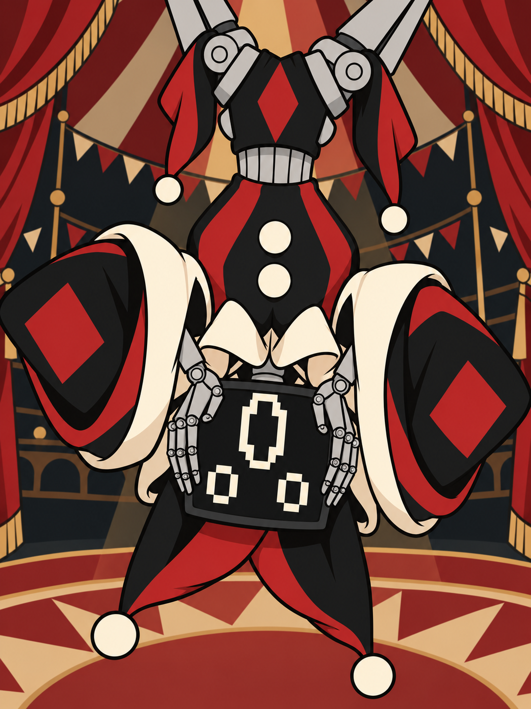

**Theme: probability, calculation and deck reconstruction.**

J-54 is a mechanical computing device designed as a circus clown. Its theatrical movements and pixel expressions are exaggerated, yet it addresses the player in cold, precise programmatic language.

Poker Head changes rules; J-54 changes the cards. Its [Table design](table-j54.html) preserves composition throughout the run while reshuffling the full deck each round. Build the economy and shape the deck first, then use contracts to start an experiment and pursue a random Capture, Eradication or Capital protocol.

The portrait can report the deck, but J-54 may alter one independently checkable number. Challenge it: catching a lie grants an item; a mistaken accusation costs chips. Lies come from seeded randomness; the LLM voices the lines and never sees deck order.

The portrait was supplied by the author; the proposed gameplay follows the [J54_TABLE.md snapshot](https://github.com/fghhn13/Chaos_Blackjack_wiki/blob/main/content/sources/J54_TABLE.md). It is unimplemented, with provisional numbers and unresolved unlock conditions and rewards.
